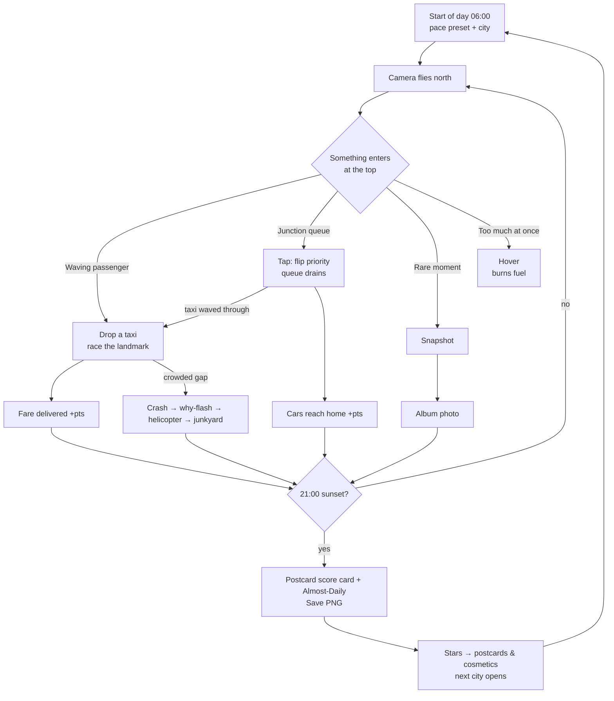

# Fuji City: Game Design Document

*Draft v2 · for Ismail · written against `city-flight.html` v15 (≈5,840 lines). Line numbers are approximate (`~`), and I've marked anything I couldn't verify in the code. v2 folds in the findings of [`MARKET-RESEARCH.md`](MARKET-RESEARCH.md). Evidence pointers like **(R§3 #1)** mean "Research section 3, theme #1"; the quotes and links live there, not here. The v1 draft is kept as `GAME-DESIGN.v1.md`.*

**What changed from v1:** taxis lead and signals support them; no hard game over, three pace presets; a six-upgrade Garage built last; three cities open from the start, stars buy cosmetics; postcards and album are the sharing engine; and a list of things we won't build. Systems moved from §4 to §5 and were reordered: v1 4.1/4.3/4.2/4.4/4.7/4.6/4.5 are now 5.1–5.7. Research §5 uses v1 numbers.

---

## 1. Pitch

**Fuji City** is a gentle rail game set inside an instant photo. The camera flies north over a procedural city and won't stop, so every waving passenger and jammed junction is on screen for about half a minute. You get one day, 06:00 to 21:00. Drop taxis for people waving landmark flags and race them there before the landmark scrolls away. Tap junctions to wave your taxi through, hover when a moment needs more time, and photograph the rare stuff: a whale, the guard sneezing, fireworks over the Eiffel Tower. At sunset the postcard becomes your score card, the *Almost-Daily* reviews your day, and you save the postcard to send to a friend. The old "just watch" movie is still one click away.

**Design pillars**
1. **Act before it scrolls away.** The moving camera *is* the timer. Nothing else is needed to create pressure.
2. **Helpful, not punishing.** Most choices make the city better. Failure is funny (the paper teases you) and never ends the day early.
3. **Every tap has a why.** A passenger wants to get somewhere. Signals and hover exist to help them get there (R§3 #8).
4. **Reuse the movie.** Signals, homes, rescues, the junkyard, the paper and the postcard already exist. The game is mostly a layer of rules on top.
5. **Sandbox stays sacred.** With game mode off, the app behaves exactly as v15 does today.

---

## 2. Market context

*Full detail, quotes and sources: [`MARKET-RESEARCH.md`](MARKET-RESEARCH.md).*

**The neighbors.** Four "traffic is the whole game" titles land within months of each other, and all four are road builders (R§1, R§2):

| Game | Status | What it is | Overlap |
|---|---|---|---|
| Traffic Architect | Steam Nov 3, 2026, demo | Roads, interchanges, transit; overflow ends the run | Low (had a free browser build) |
| Trafficity | Steam Nov 16, 2026 | 2D road puzzle; no accidents, no day/night | Low |
| Highways & Co. | Steam 2026 | Freeways-style throughput scenarios | Low; its pitch is the template (R§6) |
| Junxions | Early Access 2026 | Engineering sandbox, real-map import | None |
| Mini Motorways | 2021, 96% of 24.5k | Draw roads until overwhelmed | Medium: the "relaxing and stressful" feel |
| Traffix | 2019, 67% Mixed | Tap traffic lights in real time | High: the warning for signal tapping |

**The white space Fuji City owns** (R§4): a rail camera instead of a build-and-test loop; crashes caused only by your own spawns, cleared by helicopters; a day clock with rush hours; 19 real cities with real landmarks, five of them left-hand; satire; an instant-photo album; and a free browser game for any device, with a Sandbox for watchers. None of the four road builders does any of these.

**Where we'd lose** (R§4): road tools, engineering realism, transit, and signal tapping on its own. §7 turns that into a "do not build" list.

**Positioning one-liner:** *"You can't stop the camera. You can only help the city before it scrolls away."* Lead with "rail game", "cozy", "free in your browser". Never lead with "traffic simulator" or "city builder" (R§6).

---

## 3. What the code gives us (facts the design depends on)

| Fact | Where | Design consequence |
|---|---|---|
| `camera()` drifts north-north-east; `cameraTime += dt * flightPace` | ~4131, ~4521 | One multiplier sets rail speed; hover and presets hang off it. Things leave through the bottom and left. |
| Close zoom `ZOOM = 1.44`, `BLOCK = 152` | ~1281 | At 600 px and pace 1, a point crosses the screen in ≈42 s; a junction row appears every 15.2 s. |
| Lane speeds 14–21 u/s vs. camera 10 u/s | `laneRules` ~2084 | A northbound taxi *can* win the race. |
| Signals are global: `signalPhase() = time mod 24` | `signalState` ~3542 | Per-junction control is a new override layer. |
| `governorHolds()` and `canEnterJunction` (one vehicle per junction) | ~3537, ~3667 | **Signal changes can't cause crashes.** |
| `detectCollision` only checks `"spawn:"` vehicles | ~4371 | **Only player-spawned vehicles crash.** Taxis are the risky verb, signals the safe one. |
| `trafficDemand()` peaks at 08:00 and 17:00, capped at 1 | ~1585 | Rush hours exist. Cities differ off-peak. |
| Default clock x1800 (06:00–21:00 = 54,000 city s) | ~1234 | Game mode needs its own rate. |
| `landmarkAt()`: a flight-path landmark every 3rd block row | ~2065 | Fare destinations are guaranteed. |
| World and landmarks come from `seed` (`newSeed()` ~1565, `hash()` ~1957, `resetCity(reseed)` ~5257) | | A date-derived seed gives everyone the same city. Unverified: traffic depends on frame `dt`, so runs may not replay exactly. |
| `daylight()` and `nightEnabled = light.street > 0` | ~1572, ~1991 | Night rendering already exists. |
| One `soundVolume` (.35) feeds `soundMaster` and per-kind SFX; separate generative music (`musicEnabled`) | ~1272, ~2190, ~2230, ~1337 | Volume sliders split existing gains. |
| Helicopters deleted after exit (~4502); crusher and train hooks (~4233, ~4296); junkyard draws on `#airspace` (~4583) | | Persistent crews, coin hooks, and guard photos that crop the airspace canvas. |
| `advanceWaterLife` exits early under reduced motion | ~3954 | No whales in reduced motion. |
| Sim state lives in an IIFE; no touch-specific code found | ~906 | Tests need a gated hook (§12). Touch defaults are new work. |

---

## 4. Core loop



---

## 5. The seven systems

### 5.1 One run = one day (06:00–21:00)

**Player rules**
- **Start day** sets the clock to 06:00, locks it, and runs to 21:00. **Day length** is a setting: **10 min** (x90) or **6 min** (x150). Which is the default is decided in M1 playtests (§14). A short "arcade" session is what browser players expect (R§5, 4.1 row).
- Rush hours come from the existing curve (peaks at 08:00 and 17:00), shown as ticks on the day bar.
- During a run, clock, view-size and camera controls are locked (*"Locked for today. Try them in Sandbox."*). At 21:00 input stops, 5 s of quiet credits fly by, then the score card appears.

**No hard game over** (R§3 #8, Traffix lessons). Nothing ends a day early: no overflow, no strike limit, no fail screen, and the score can't go below 0. A terrible day still gets a `☆☆☆` postcard and a teasing paper. Helicopters always clear wrecks, so a pile-up never locks a junction for good (a Traffix complaint).

**Pace presets** (R§5, 4.4 row), shown on the postcard. Slower is a valid way to play, not a cheat: **stars count the same in every preset** (they no longer gate access, §5.6).

| Preset | Camera pace | Fare interval | Signal hold | Token regen |
|---|---|---|---|---|
| **Sunday drive** | ×0.8 | 35 s | 12 s | 5 s |
| **Commute** (default) | ×1.0 | 25 s | 10 s | 6 s |
| **Rush** | ×1.15 | 18 s | 8 s | 8 s |

**M1 tuning (scripted full-day simulations, before human playtests).** Recorded per M1 Step 12; replace with playtest numbers when they exist.

| Value | Draft | Tuned in M1 | Why |
|---|---|---|---|
| Base flight pace at 600 px Close | ×1.4, `clamp(viewHeight/ZOOM/300, .7, 1.5)` | ×1.0, `clamp(viewHeight/ZOOM/420, .6, 1.2)` | At ×1.4 the camera (14 u/s) outran taxis queued behind 11–16 u/s ambient cars on single-lane streets; no fare was ever delivered |
| Fare destination window | next flight-path landmark, deadline when its block's south edge scrolls off | flight-path and in-view landmarks whose drop-off curb leaves the print in 28–90 s; deadline is that curb | More destinations and a deadline the taxi can see |
| Pickups | home curbs on east-west streets, top 45% | any dry curb in the top 50%, on east-west lanes and northbound north-south lanes, nearest to the drop-off first | Home curbs alone gave 1–5 candidates and 36–50 s waits for the first fare |
| Fare validation | `routeHome` not null | route exists and estimated trip (length/14 + 6 s per junction) ≤ 75% of the time left (90% after a full interval without a fare) | Most valid routes looped through 4+ red junctions and were unwinnable |
| Taxi speed | lane speed × spawn factor | ≥ lane speed × 1.2 when the curb gap is safe | Taxis are the hero vehicle |
| Waiting cost | −0.25 per vehicle-second beyond 8 s | −0.125 per vehicle-second beyond 24 s, at most 4 vehicles at once | Normal reds last up to 18 s; the draft drained every day to 0 |
| Junction grades | every junction with a queue | only junctions you flipped, peak queue ≥ 3; Smooth ≤ 24 s, Jammed > 36 s | Passive days earned ~600 free points |
| Stars (10 min) | 400 / 800 / 1,200 | 300 / 600 / 900 | A passive day scores ~0; steady taxi play 100–1,000 |

**Daily seed** (R§5, 4.1 row). A **Daily** button plays today's day: seed and city come from the local date, cycling through all 19 cities, so everyone gets the same streets and landmarks. It uses Commute, a 10-min day and no upgrades. The first finished attempt is the "Daily best", and the postcard shows `Daily · Oct 7 · Lisbon · #4821`. There's no server leaderboard: players compare by sharing the postcard PNG (§5.5), which keeps the README's privacy promises.

**Score card (the postcard).** `syncCityPostcard()` (~1107) gains a `poem-score` mode: line 1 `9/11 fares · 142 home · 2 wrecks · ★★☆`, line 2 the city's existing closing verse, and the poet signature (*"— Senior Vice President of Light Drizzle, certifying 1,040 pts"*). The small-print version must pass the footer-fit checks from 100 to 1000 px (`tests/postcards.mjs`).

**Local paper.** At day end, `syncCityNewspaper()` (~1084) puts up to three generated stories in front of the `citySatire` ones:

| Condition | Headline template |
|---|---|
| wrecks = 0 | "{City} completes entire day without a single dent; insurers report boredom" |
| fares ≥ 90% | "Taxi passengers reach {landmark} so fast they forget why they went" |
| max queue ≥ 8 | "Queue at {junction} declared a new neighborhood; residents elect a mayor" |
| landmark event attended | "{Landmark} fireworks a success; {n} taxis claim credit" |
| ★★★ | "City council renames sunset 'the commute'; nobody objects" |

Keep the **"entirely made up / local satire"** label. The edition line becomes `DAY {n} EDITION` (or `DAILY EDITION · Oct 7`).

**Build plan:** a `game` object (`{active, day, preset, daily, score, stats, phase}`) after `resetCity`; `advanceGame(dt)` called from `tick()` (~5150) after `advanceClock`; clock handlers (~5329–5370) gated with `if (game.active) return`; optional result parameters on `syncCityPostcard`/`syncCityNewspaper`; for the Daily, set `seed` from the date before `resetCity(false)`.

**Edge cases:** reduced motion starts paused (~1348), so "Start day" explicitly plays. Changing city mid-run asks *"Abandon today?"*. Runs can't resume after a reload.

### 5.2 Passengers and taxis (the headline verb)

This is what gives every other action a reason (R§5, 4.3 row; R§3 #8). Tutorials, trailers and the store page all lead with it.

**Player rules**
- A passenger appears on a curb in the top 45% of the view, waving a flag with a **landmark icon** (usually the next flight-path landmark). Interval per preset ±8 s, at most **2 waiting**.
- Tap any lane within **35 world units** to drop a gold taxi. The passenger hops in and the taxi routes to the landmark's curb.
- **Deadline:** arrive before the landmark's block scrolls off the bottom. A shrinking arc on the flag shows the time left (typically 30–55 s).
- Unpicked passengers who scroll off count as **Missed**: no points lost, but the fare streak resets.
- **Spawn tokens:** every spawn, taxi or car, costs 1. Regen per preset, bank up to 3, shown as dots next to the score.
- **Spawn preview:** the cursor ring is green when `planSpawn(...).safe`, amber for a crowded gap.

**Crash-cause flash** (R§5, 4.3 row; RUSH feedback in R§2). When a spawned vehicle crashes, show *why* before the helicopter arrives: for **0.6 s** the spawned vehicle and the one it hit get a red outline, the gap it was dropped into gets a ghost of the amber preview ring, and `#status` says *"Crash: taxi dropped into a crowded gap."* Under reduced motion it's a static outline for 1.5 s.

**Scoring**

| Event | Points |
|---|---|
| Fare delivered | +40, plus 1/s remaining (max +20), plus 5 coins |
| Fare streak 3 / 5 / 10 | ×1.1 / ×1.2 / ×1.3 on fare points |
| Fare failed (crash, deadline, retired off-view) | −10 |
| Any vehicle reaches home in view (`parkAtHome` ~3706) | +10 (+5 if player-spawned) |
| Wreck, per vehicle (`beginCollision`) | −30 |
| Vehicle lost in water (`loseInWater`) | −50 |

**Controls**
- **Mouse/touch:** one tap near the passenger. No double-taps or long-presses anywhere in game controls (R§5, 4.2 row).
- **Keyboard:** `F` cycles waiting passengers (announced with destination and time left); `T` sends a taxi from the nearest legal lane (`aimAtLane()` ~5202).
- **Reduced motion:** still flags, deadline as text ("22 s").

**Build plan**
1. `const fares = []`, generated in `advanceGame` from `landmarkAt` (~2065) and validated with `routeHome` (~3443) on a dummy vehicle; unreachable fares are skipped. Drop-offs mimic `homesForBlock` (~2997), with the curb side flipped for left-hand cities.
2. Taxi: `spawnAt` with an options bag (`paint:"gold"`, `vehicle.fare`, no `assignHome`). Completion in `updateTraffic` (~3878) when it reaches its curb; failure in `beginCollision` (~4330) and `retireVehicle` (~3684).
3. The crash flash also hooks `beginCollision`, storing `{a, b, gap, until}` for `draw()`.
4. Flags use `landmark()` (~2528) at small scale. Unverified at 12 px; fallback is a letter badge.

**Edge cases:** island landmarks are skipped by validation. A taxi behind a wreck re-routes via the 5 s `retryAt`. With Collisions off, taxis can't crash; the run is marked "Relaxed" and capped at ★★.

### 5.3 Signal tapping (the supporting verb)

Light tapping alone plays like a QTE (Traffix, Mixed), and Mini Motorways players asked for a click that prioritizes a different flow (R§3 lessons). So a tap is a visible **priority flip** that matters mostly because it frees your taxis.

**Player rules**
- **One tap** on a junction gives green to the other direction: amber 1 s, all-red 0.5 s, then a hold (length per preset), then back to the global 24 s cycle. Tapping again during a hold flips it back.
- **Taxi priority flip:** if one of your fare taxis is waiting at the junction, the ring shows a gold taxi chip and the tap gives green to *the taxi's* side. A fare taxi that crosses on a green you gave earns **+5 "waved through"**.
- **Visible queue draining:** approaches with ≥3 waiting (or any, on focus) show a count badge that counts down after a tap, and **"+N through"** pops when the hold ends.
- **Safety wins:** under `governorHolds` (pedestrians, wreck, reservation) the tap is *queued* with a walker icon. Taps never cause crashes, and the first tip says so.
- Roundabouts (~18% of nodes) aren't tappable ("↻ self-running").
- Junctions are graded when they leave the screen: **Smooth** (nobody waited >10 s) +5, **Jammed** (anyone >25 s) −5. Waiting beyond 8 s costs −0.25 per vehicle-second.

**Controls**
- **Mouse/touch:** hit radius `max(22 world units, 24 CSS px)` around the junction (≥44 px at Close). Taps elsewhere on a lane still spawn.
- **Keyboard:** `J` / `Shift+J` cycles junctions, `Enter` flips. `#aim-status` reads *"Junction, 4 waiting north-south, your taxi waiting east-west."* Reduced motion drops the ring pulse.

**Build plan**
1. `signalOverrides` (a Map beside `junctionReservations` ~1257) applied in `signalState` (~3542) after `governorHolds` and before the global phase. `drawJunction` (~4994) and `canEnterJunction` follow automatically.
2. In the click handler (~5179), hit-test junctions before `spawnAt`.
3. Extend `auditTrafficGovernor` (~3555, every 0.5 s) to count waiting vehicles per approach (badges), spot fare taxis (chip) and record max wait (grades).
4. Unverified: `signalClocks` in `step()` (~4516) keep using the global cycle, which I think is right.

### 5.4 Hover and pace

**Base pace.** At 600 px Close, `flightPace = 1.4` (≈30 s top to bottom), then multiplied by the preset. General formula: `clamp(viewHeight/ZOOM / (10 × 30 s), 0.7, 1.5)`. Stars are only awarded at calibrated print sizes (§14).

**Player rules**
- Hover eases `flightPace` to **0.15** over 0.3 s and back on release. Traffic, signals, taxis and the clock keep running; scroll-based fare deadlines slow down, which is the point.
- **Fuel:** 100 units, burns 20/s, refills 4/s, needs ≥15 to start. Unused fuel at day end gives +0.5 pts per unit.

**Controls**
- **Mouse/keyboard:** hold the right button, the on-frame **Hover** pill, or `H`.
- **Touch: Hover toggles by default** (tap once on, once off) via `matchMedia("(pointer: coarse)")`, because a held thumb covers the city (R§5, 4.4 row). The toggle is also a desktop setting for players who can't hold a key.
- **Calm flight** (motion-sensitive players): the camera moves in steps, one block row every `15.2/flightPace` s. Stars count normally.
- **Reduced motion:** pace changes instantly.

**Build plan:** `let hover={held:false,fuel:100,pace:1}`; in `step()` (~4521) use `dt*flightPace*preset.pace*hover.pace` during runs; Calm flight quantizes inside `camera()` (~4131). Pausing freezes fuel; blur releases a held (not toggled) hover.

### 5.5 Album and postcards (the sharing engine)

Postcards and photos are how Fuji City spreads: one good screenshot decides interest, and TOEM and Mini Motorways' GIF export point the same way (R§5, 4.7 row; R§2).

**Save PNG**
- **Day-end postcard:** **Save PNG** composites the city canvas and the Polaroid footer (score, verse, signature, city, date, preset, Daily seed) into `fuji-city-lisbon-2026-10-07.png`. The footer is HTML, so it's redrawn on a canvas. Where `navigator.canShare({files})` works, offer **Share** instead.
- **Album photos:** every photo gets its own Save PNG in the same frame.
- **Later:** "Copy link" with `?daily=2026-10-07` so a friend can play the same day.

**Snapshot rules**
- Press **P** (or the on-frame shutter) to take a photo: a 0.15 s white flash (none under reduced motion), scored by subject.
- **8 exposures per day.** The best shot per subject per city goes into that city's album (6 slots).
- **Rare-moment hints** in `#status` (*"The guard is stirring…"*) set up good clips.

| Subject | Detection | Pts |
|---|---|---|
| Whale surfacing | `surfacing` in frame (~3953) | 60 |
| Guard sneeze (once per roll, City options open) | `junkyardWorker.phase==="sneeze"` (~4217) | 50 |
| Landmark event (§6.4) | event active, venue in frame | 45 |
| Landmark at sunset | `landmarkAt` in frame, hour 19.5–21 | 40 |
| Steam train departing | `junkyardTrain` present | 35 |
| Helicopter lifting a wreck | incident in `pickup`/`carry` | 30 |
| Crash, boat under a bridge | fresh incident / `marineBoats` + `isBridge` | 20 |
| Any landmark | `landmarkAt` in frame | 10 |

**Composition, kept simple:** fully in frame ×1.0, partly ×0.6, golden hour ×1.15 (v1's thirds and two-subject bonuses are cut). Under reduced motion, a "Still Life" set (parked helicopter, stationary train, sleeping guard) replaces whales.

**Storage:** metadata in `fuji-city:album:v1`; 240 px JPEG thumbnails in IndexedDB (~10 KB each), with a drawn "stamp" card if IndexedDB fails. Full-size PNGs are rendered at save time, from the live frame or a capture kept in memory for the day, and never stored.

**Build plan:** `takeSnapshot()` on `p`; subjects via `worldToScreen` (~5043); `canvas.toBlob` from `#city` or a crop of `#airspace`; one shared `renderPolaroid(image, caption)` for postcards and photos.

### 5.6 World tour

**Three cities open from the start** (R§5, 4.6 row; R§3 #5, #11): **Original** (tutorial: dry, fictional landmarks, demand ×0.6), **Paris** (an instantly recognizable skyline) and **Tokyo** (left-hand traffic, and it fits the "Fuji" name). Real places and left-hand traffic then show up in the first session instead of hours in.

**Play opens cities, stars buy cosmetics.** Finishing any day, at any score, opens the next city on the tour. Nobody gets stuck behind a level they can't beat, which was Traffix's complaint (R§5). Stars earn:
- each city's **postcard stamps** (★, ★★, ★★★ editions of that city's card)
- **paper editions**: a front-page special at ★★★
- **album pages and frames** (sepia, gold-edged)
- at cumulative milestones, **taxi paints** and **frame styles**

**Tour order** (gentle to busy, interleaving left-hand cities): Bruges (.43) → Dubrovnik (.35, first whales) → Kyoto (.59, left) → Antalya → Dublin (left) → Amsterdam → Lisbon (wide river) → Barcelona → Munich → Seattle → Ibiza → Istanbul → London (left) → Mexico City (dense dry grid) → Singapore (left) → New York. Traffic values are from the `cities` table (~947–1002).

**How cities differ:** `traffic` (.35–1.08) shows off-peak; big cities add pace +5–10%; left-hand flips lanes and curbs; rivers make bridge chokepoints; coasts bring whales.

**Stars per day:** ★ ≥ 400, ★★ ≥ 800, ★★★ ≥ 1,200 for a 10-min day, scaled ×0.6 for 6 min and by a per-city `par` (placeholders until M1 tuning). Best stars per city are saved.

**UI and build:** a notebook "Tour" strip of 19 mini postcards, unopened ones in sepia ("Finish a day to open"); Sandbox keeps every city. A `tour` table (`order, par, demandScale, fareInterval, paceBonus, open`) sits beside `cityDefaults` (~1203).

### 5.7 Junkyard coins and the Garage (smaller, built last)

Coins add flavor and never gate fun. The economy is the last core system built (R§5, 4.5 row).

**Coins in:** crushed car 3 (`advanceCrusher` ~4233), +2 per vehicle in a train batch (~4296), fare 5, day stars 10/25/50. A crash costs −30 pts but pays ~5 coins, so crash farming never pays. Rough income is ~105 coins a day. Until M6, coins just collect on the postcard.

**Garage: six upgrades**

| Upgrade | Effect (hook) | Cost |
|---|---|---|
| Crew Two | One persistent helicopter, never deleted on exit (skip the delete at ~4502) | 120 |
| Smart signals I | Holds last +4 s | 90 |
| Big tank | Fuel 100 → 150 | 90 |
| Token pocket | Max tokens 3 → 4 | 110 |
| Taxi radio | Taxis show their route as a dotted line | 70 |
| Wide lens | Snapshot frame +25% | 50 |

**Refund all** (100%, between days) stays. Upgrades are off in Daily and Sandbox. Cut from v1: Crew Three, Turbo rotors, Smart signals II, Quick refill, Gentle flight (replaced by pace presets), Crusher overdrive, Guard's whistle.

`resetCity` (~5280) clears helicopters, so re-insert the crew after reset.

---

## 6. New features from the research

### 6.1 Night print (dark palette)
Dark mode was Trafficity's most requested feature after transit (R§3 #12), and Fuji City already renders night (`daylight()`, `nightEnabled`). A **Night print** setting darkens the frame, notebook and paper through CSS variables (default: `prefers-color-scheme`). In Sandbox it also renders the city at night regardless of the clock; in Day runs the city follows the clock. Unverified: how many draw paths read `daylight()` directly.

### 6.2 Volume sliders
Traffix and Mini Motorways reviewers complain about missing them (R§5). Replace the single **Sound on/off** (`#sound`, ~687) with three sliders: **Music**, **City** (spawn, collision, pickup, splash, whistle, chuff, sneeze) and **Game** (fares, shutter, taps). Split `soundVolume` (~1272) and scale the per-kind volumes (~2230). Persist in settings and keep a mute shortcut.

### 6.3 Phones, iPad and Mac
"Can I play it on my device?" was the #1 theme (R§3 #1). Being free and in the browser is our answer, so it has to actually work there:
- tap targets ≥44 px; Hover toggle on touch (§5.4)
- a single-column layout that fits a 375 px phone without horizontal scroll
- no mouse-hover-only information: queue badges show on their own at ≥3 waiting, and the spawn preview appears on touch-down
- Playwright WebKit iPhone and iPad profiles in CI, plus a manual pass on a real iPhone, an iPad in both orientations, and Mac Safari before each milestone closes

### 6.4 Landmark rush events
Traffic Architect's demo climaxes with a stadium emptying onto your roads (R§5). Ours is gentler and feeds the album. **One event per day** is announced in the morning paper and HUD (*"Fireworks at 20:30"*). Fifteen game-minutes before, the next flight-path landmark ahead becomes the venue. For the window, fares all point there at half the interval, and the venue draws its event (fireworks, parade, lanterns), a 45-pt album subject. Events come from a per-city `{kind, hour}` table.

### 6.5 Honest making-of note
AI-use arguments swallowed the Traffic Architect threads, and r/tycoon requires disclosure (R§3 #4). The itch/Steam page and launch posts carry a short "How Fuji City was made" note, including any AI-tool use. It's a launch task, not code (M7).

---

## 7. What we're not building (and why)

These are popular requests, but each pulls Fuji City into the crowded part of the market or breaks the rail camera (R§4, R§5).

| Not building | Why not |
|---|---|
| **Public transit** | A top-3 request, but Traffic Architect has it, and route planning is a build loop the rail camera can't support. Our transport fantasy is the taxi. Don't promise it in posts. |
| **Road building / interchanges** | It's the core of all four competitors and the part of the market where we lose. Roads that scroll off in 30 s can't be designed, and road tools invite the engineering critics (R§4). |
| **Real-map import (OSM)** | Junxions does it deeply. It would mean data size and attribution work, and real layouts would break the generator's guarantees (landmarks every 3rd row, routable fares). Copy says "19 real cities, real landmarks", and is honest that the streets are procedural (R§4). |
| Also not now: online leaderboards and accounts | Privacy promises in the README. The Daily plus a shared PNG covers comparison. |

---

## 8. Modes

| Mode | What changes |
|---|---|
| **Sandbox** (default on first visit) | v15 exactly, plus Night print and volume sliders. No HUD. |
| **Day run** | §5.1–5.7 active, any open city, any preset. |
| **Daily** | Today's seed and city, Commute preset, 10 min, no upgrades. |
| **Practice day** | Any print size or clock rate, no stars, coins at 50%. |

A **Sandbox / Play a day / Daily** switch sits next to Pause. The first Day run shows three one-time tips, in order: *"Tap near a waving flag to send a taxi"*, *"Tap a junction to wave your taxi through"*, *"Hold H (or tap Hover) to slow the camera."*

---

## 9. HUD / UI sketch

The HUD lives in the **Polaroid's white footer** during a run. At sunset it hands back to the poem area, which writes the score card.

```
┌──────────────────────────────────────────┐
│      city canvas                         │
│   ⚑🗼 passenger flag + deadline arc      │
│   ◯ 4↓ 🚕→  junction ring, queue badge,   │
│            taxi chip                     │
│                                [Hover ▮▮▯]│ ← on-frame pills
│                                [ ◉ 6/8 ] │ ← shutter + film left
├──────────────────────────────────────────┤
│ 06 ─▲──────●─────✦───▲────── 21   1,040  │ ← day bar, rush ▲, event ✦
│ ● ● ○ tokens  fuel ▮▮▮▮▯  ×1.2  Commute  │
└──────────────────────────────────────────┘
        [ Save PNG ]  [ Share ]  (at day end)
```

- Cards reuse the `.journal-counts` tiles (~468). The Chronicle gets a "Today" row (**Fares · Home · Wrecks · Score**) and new `recordCityEvent` kinds (`fare`, `signal`, `photo`, `event`, `day-end`).
- The notebook gains **Tour**, **Album** and (from M6) **Garage** panels.
- Live regions announce fares, deadlines under 10 s, crash causes, events and day end, never score ticks. Prints ≤300 px collapse the HUD to one line.

---

## 10. Save data (`localStorage`, existing key style)

Follow the `fuji-city:<name>:v1` pattern and wrap every access in try/catch with a visible message, as `storageError` does (~5580).

| Key | Shape |
|---|---|
| `fuji-city:game-progress:v1` | `{v:1, coins, days, opened:["original","paris","tokyo",…], stars:{paris:2}, best:{paris:1040}, cosmetics:{…}, upgrades:{…}, daily:{"2026-10-07":{score, stars}}}` |
| `fuji-city:game-settings:v1` | `{mode, preset:"commute", runMinutes:10, hoverToggle:null /*auto by pointer*/, calmFlight:false, nightPrint:"auto", volume:{music:.35, city:.35, game:.35}}` |
| `fuji-city:game-tips:v1` | `{fare:"done", signal:"done", hover:"done"}` |
| `fuji-city:album:v1` | `[{id, city, subject, score, clock, day, seed}]` (thumbnails in IndexedDB) |

Without storage the game still plays, says *"Progress won't be saved in this browser"*, and opens everything for the session. No new analytics events without updating the README table and `tests/analytics.mjs`.

---

## 11. Recommended build order

The taxi loop and touch play come first (the differentiator and the #1 ask), then sharing (how people find the game). The Garage comes last.

| Milestone | Scope | Effort | Done when |
|---|---|---|---|
| **M0 Plumbing** | `game` state, mode switch, locks, `?game-test=1` hook | 1–2 days | Sandbox unchanged, all existing tests green |
| **M1 Core day** (§5.1–5.3) | Day timer, no game over, pace presets, taxis and tokens, crash-cause flash, signal flips with queue badges and taxi priority, postcard card, paper | 7–10 days | 5 playtests (2+ on phone/iPad) *want another day* and can explain their crashes |
| **M2 Hover and touch** (§5.4, §6.3) | Fuel, touch toggle, Calm flight, mobile layout, WebKit device tests | 2–3 days | A full day is playable on iPhone and iPad with no layout breaks |
| **M3 Sharing** (§5.5, Daily) | Save PNG/Share for postcards, album and snapshots, Daily seed | 4–6 days | Two devices get the same Daily city and swap postcards |
| **M4 World tour** (§5.6) | 3 open cities, play-to-open, star cosmetics | 2–3 days | Original, Paris and Tokyo open on first run; a finished day opens Bruges |
| **M5 Atmosphere** (§6.1, 6.2, 6.4) | Night print, volume sliders, landmark rush events | 3–4 days | One event per day fires and is photographable |
| **M6 Garage** (§5.7) | Coins UI, six upgrades, refunds | 2–3 days | About one upgrade per day of play |
| **M7 Polish and launch** | Accessibility, small prints, tuning, v16 archive entry, itch/store page with the making-of note, launch clip | 3–4 days | Launch posts follow R§6 (native video, "for people who…" pitch, payoff in 2 s) |

Launch timing: Traffic Architect (Nov 3) and Trafficity (Nov 16) will have the genre searching. Post around then as "something different while you wait", not as a rival road builder (R§6).

---

## 12. Tests (Playwright, `bun tests/<name>.mjs`)

`tests/` isn't in this copy, so these follow the README's descriptions. **Test hook** (only with `?game-test=1`): a frozen `window.__fujiGame` with `state()`, `advance(seconds)` (deterministic 0.02 s steps), `junctions()`, `setDay(seconds)`, `forceSubject(name)`.

| Test | Checks |
|---|---|
| `day-run.mjs` | 06:00 start at x90/x150, clock locked, 21:00 ends input. **No early end** with 20 forced wrecks; score floors at 0. Presets apply. Postcard fits 100–1000 px. |
| `fares.mjs` | Routable fares only, delivery, deadline fail, left-hand curbs, tokens, preview ring. **Crash flash** outlines both vehicles for 0.6 s and writes the cause to `#status`. |
| `signals.mjs` | One tap: amber → all-red → hold → global cycle; queued under `governorHolds`; 1,000 random taps produce 0 incidents. **Badge counts down**; **taxi chip** flips toward the taxi and pays +5. |
| `hover.mjs` | Fuel rules. Toggle by default on a coarse pointer. Calm flight steps. |
| `sharing.mjs` | Save PNG yields a correctly sized image with footer; Share path when `canShare` is stubbed; same date → same seed, city and landmarks. |
| `album.mjs` | Subjects (forced), multipliers, 8-exposure limit, IndexedDB and stamp fallback, reduced-motion set. |
| `world-tour.mjs` | 3 cities open on a fresh save. Finishing a ☆☆☆ day opens the next city. Stars grant cosmetics only. Sandbox has all 19. |
| `atmosphere.mjs` | Night print defaults and Sandbox night; sliders scale gains and persist; one event per day with retargeted fares. |
| `mobile.mjs` | WebKit iPhone and iPad profiles: no horizontal scroll at 375 px, tap targets ≥44 px, a scripted full day completes. |
| `economy.mjs` | Coins counted once; six upgrades buy and refund; crew survives `resetCity`; off in Daily. |
| existing suite | All 14 README tests with game mode off, plus `stress.mjs --rounds=10` mid-day. |

---

## 13. Risks

1. **Is it fun?** Taxis carry the stakes now, so signals only need to feel useful. If M1 feels flat, let Rush-preset taps skip the global fallback.
2. **Phones are a target now** (R§3 #1). Dwell time depends on `viewHeight/ZOOM`, and a locked print size is awkward on narrow screens. M2 must solve this, not just test it.
3. **Performance.** Spawn preview, fare validation, badges and PNG rendering all run on the main thread. Watch `stress.mjs` and low-end phones.
4. **Crowded launch window** (two Steam launches in November). The defense is positioning (§2) and dodging the "is this Mini Motorways?" reflex (R§3 #2).
5. **Daily fairness.** Traffic may not replay identically, so the Daily means "same city, same day", not identical runs.
6. **Single-file growth** (~1,000–1,400 lines): keep game code in a `// GAME MODE START/END` block.
7. **Reduced motion vs. a rail game:** test Calm flight with players who need it.

---

## 14. Open questions

1. Evening rush at **17:00** (code) or **18:00** (brief)? Moving it changes sandbox pedestrians too. I'd keep 17:00.
2. Default day length: **6 or 10 minutes**? Research leans short for browser players (R§5). Decide in M1.
3. Which left-hand city opens first: **Tokyo** (name fit, busiest), **Kyoto** (gentler) or **London** (most recognizable)?
4. Daily rotation: all 19 cities (proposed) or only the three open ones?
5. Which print size is calibrated for stars on phones, where 600 px won't fit?
6. Should Collisions-off runs earn stars? (Proposed: ★★ cap.)
7. Does `landmark()` read as a 12 px flag icon? Needs a quick prototype.
8. Does the generative music go through `soundMaster`, or does it need its own gain node for the Music slider?
9. Make Daily traffic deterministic (fixed `dt`)? Only if players ask for real leaderboards.
10. Any new analytics events at all, given the privacy language?
