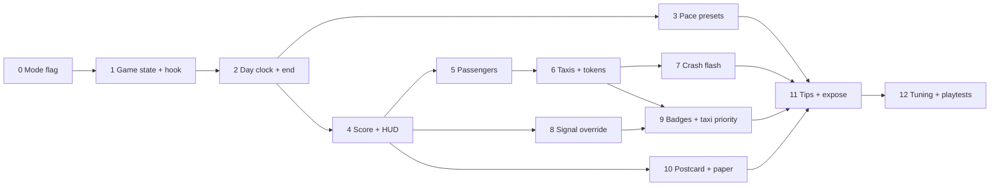

# Fuji City M1 Build Plan: the core day

*For Ismail · Oct 7, 2026 (PT) · implements M1 of [`GAME-DESIGN.md`](GAME-DESIGN.md) v2 (§5.1–5.3, §8, §11). Every hook below was checked against `city-flight.html` v15 (5,843 lines). The file wasn't modified. Line numbers are approximate (`~`). Anything I couldn't confirm in the code is marked **unverified**.*

**M1 scope:** the Day run with pace presets and no hard game over, taxis with the crash-cause flash, one-tap signals with queue badges and taxi priority, and the score postcard and paper, with Sandbox unchanged. Hover, the album, Daily, the tour and the Garage come later.

**Ground rules for every step**
- All game code lives in one `// GAME MODE START … END` block inside the main IIFE (opens ~906). Existing functions only get **one-line guarded hooks** like `if (game.active) gameOnX(...)`.
- With game mode off, **every hook is a no-op**. The 14 README tests (`bun tests/<name>.mjs`) must pass after every step.
- Until Step 11, game mode is only reachable with `?game=1`, so production visitors see v15 exactly.

---

## Cross-cutting code facts

Step-specific hooks are cited inside each step. These facts shape the whole plan:

| Fact | Where | Consequence |
|---|---|---|
| `tick()` advances the clock with real `dt × cityClockRate`, then `advanceJunkyard`, then `step(min(dt,.1))`, then `draw()` | ~5150 | The clock and the sim drift on slow frames. Tests need one shared frame function |
| `step()` updates crossings, `cameraTime += dt*flightPace`, traffic in 0.02 s substeps, `detectCollision`, then `auditTrafficGovernor()` every 0.5 s | ~4509 | One place for the camera pace and the per-frame game update |
| `clockSeconds` wraps at 86,400 (`advanceClock`); `setCityTime` redraws and overwrites `status` | ~1913, ~1935 | The day end uses an elapsed counter |
| `paused = reducedMotion.matches` at load | ~1348 | Start day must explicitly play |
| Helpers such as `hash`, `daylight`, `landmarkAt`, `trafficDemand` are serialized with `toString()` into the Terrain and Walkers workers | ~5791 | Game state must never be referenced inside them |
| `journalCounts` is filled by the Chronicle worker, which only counts four kinds; other kinds become log lines | ~1243, ~1599 | Game stats live on the main thread |
| `newSeed()` (crypto) is used per spawn for kind, personality and pace | ~2378, ~3740 | Runs don't replay exactly |
| URL params are parsed only in a head IIFE (~9) | | The main IIFE (~906) needs its own `URLSearchParams` |

---

## Steps

### Step 0: Mode flag and switch (3 h)
**Goal:** the app knows "sandbox" vs "day" without changing anything else.
- **Touches:** `const gameParams = new URLSearchParams(location.search)` in the main IIFE, with `GAME_FLAG` (`game=1`) and `GAME_TEST` (`game-test=1`). The `.primary-options` row (`#pause` ~686) gets a hidden `<button id="game-mode" aria-pressed="false">Play a day</button>` in the existing Gamified button style, shown only with the flag.
- **Test:** `tests/game-mode.mjs`: without `?game=1`, `#game-mode` is hidden and the DOM snapshot of `.primary-options` matches today's; with it, the button shows. Seed the completed first-play hint the way other regressions do (README).
- **Done when:** the existing 14 tests pass and `game-mode.mjs` passes.

### Step 1: Game-state module and test hook (5 h)
**Goal:** one object owns the run, plus a deterministic way for tests to drive it.
- **New state:**
```js
const game = { active:false, phase:"idle",          // idle|running|dusk|card
  preset:"commute", runMinutes:10, day:0, relaxed:false,
  stats:{score:0, home:0, fares:0, missed:0, failed:0, wrecks:0, waved:0, maxQueue:0},
  tokens:3, nextToken:0, fares:[], flash:null, elapsedCity:0, saved:null };
```
- **Refactor (behavior-neutral):** move `tick()`'s body between `lastSimulationFrame=now` and `draw()` into `function frameAdvance(dt)`, so `tick` and the test hook run the same order (clock → `trackAnalyticsPlayTime` → `advanceJunkyard` → `step`). Inside `step()` after `auditTrafficGovernor()` (~4527), add `if (game.active) advanceGame(dt);`.
- **Hook (only with `?game-test=1`):** a frozen `window.__fujiGame` with `state()`, `advance(sec)` (a `frameAdvance(.02)` loop, no rAF), `junctions()`, `fares()`, `screenOf(x,y)` (via `worldToScreen` ~5043, in CSS px), `tapWorld(x,y)` and `setClock(s)`.
- **Test:** extend `game-mode.mjs`: the hook is absent without the param, and `advance(10)` moves `cameraTime` by about `10 × flightPace`.
- **Done when:** the stress test (`stress.mjs --rounds=10`) shows no regression after the `frameAdvance` refactor.

### Step 2: Day clock, locks, end of day (6 h)
**Goal:** Start day → 06:00 → 21:00 → card, with nothing ending early.
- **Touches:** `startDay()` saves `{cityClockRate, clockSeconds}`, calls `resetCity(true)` (~5256) and `setCityTime(6*3600)` (~1935), sets `cityClockRate = 54000/(runMinutes*60)` (x90 or x150) with `syncClockRate()` (~1918), and un-pauses via `syncPlayback()` (covers the reduced-motion start). `advanceGame` ends the day when `game.elapsedCity` (summed `dt*cityClockRate`) reaches 54,000. It doesn't compare the wrapping `clockSeconds`. Clock-vs-sim drift is accepted for M1 and logged as `state().simLag`.
- **Locks:** guard the clock-daylight (~5329), slower/faster (~5331), drag (~5341), clock keyboard (~5362), `fps` (~5371), `camera-view` (~5377), `print-format` (~5383) and `view-size` (~5388) handlers with `if (game.active) return lockedNotice();` (*"Locked for today. Try it in Sandbox."*). `destination` (~5308), `new` and `reset-view` (~5306) ask `confirm("Abandon today?")` first.
- **End:** at 21:00, `phase="dusk"` ignores taps for 5 s of sim, then `endDay()` (Step 10) restores the clock rate and clears `game.active`. **No hard game over:** nothing else reaches the card, and the test asserts it.
- **Test:** `tests/day-run.mjs`: 06:00 at x90/x150 (`#clock` `aria-valuetext`); locked controls don't change the clock; `advance(600)` at x90 reaches the card; the abandon prompt (`page.on("dialog")`); reload resumes nothing; a `reducedMotion:"reduce"` context starts playing.
- **Done when:** a 10-minute day completes hands-off in a real browser, and Sandbox's clock behaves as before afterwards.

### Step 3: Pace presets (3 h)
**Goal:** Sunday drive / Commute / Rush change pressure without touching Sandbox.
- **Data:**
```js
const PRESETS = { sunday:{pace:.8, fare:35, hold:12, regen:5},
                  commute:{pace:1, fare:25, hold:10, regen:6},
                  rush:{pace:1.15, fare:18, hold:8, regen:8} };
```
- **Touches:** in `step()` (~4521), change `cameraTime += dt * flightPace` to `cameraTime += dt * flightPace * cameraFactor()`, where `cameraFactor = () => game.active ? BASE_PACE * PRESETS[game.preset].pace : 1`. `BASE_PACE` comes from the GDD formula `clamp(viewHeight/ZOOM/300, .7, 1.5)`, about 1.4 at 600 px Close. The 300 px and full-window dwell times are **unverified** in play.
- **UI:** a paper-style Start card with three `.journal-counts`-style preset tiles, a 6/10-min toggle and **Start day**. Settings go in `fuji-city:game-settings:v1` using the `storageError` pattern (~5580).
- **Test:** in `day-run.mjs`, for each preset, `advance(10)` moves `cameraTime` by `10 × BASE_PACE × pace` (±2%). With the flag off, the factor is exactly 1.
- **Done when:** Rush feels clearly faster than Sunday drive in a 2-minute manual check.

### Step 4: Score core, HUD footer, Today row (6 h)
**Goal:** the score is visible and correct even before fares exist.
- **Hooks (one line each, guarded):**
  - `parkAtHome` at the `homecomings++` line (~3706): `gameOnHome(vehicle)` gives +10, plus 5 if the id starts with `"spawn:"`.
  - `beginCollision` (~4330, after `incidents.push`): `gameOnCrash(cars)` gives −30 per car and `wrecks++`.
  - `loseInWater` (~3764, vehicle branch): −50.
  - `auditTrafficGovernor` (~3555, every 0.5 s): −0.125 per vehicle whose `waitSince` is older than 8 s, plus `maxQueue`.
- **Rule:** `score = Math.max(0, score)` after each change, so there's no negative spiral.
- **Collisions off:** if `collisionsEnabled` is false at Start or toggled (~5242), set `game.relaxed = true` (★★ cap at the card).
- **UI:** `#game-hud` after `#city-poem` (~641) overlays the Polaroid footer during a run (`figure[data-game="running"] #city-poem {visibility:hidden}`). It holds the day bar with rush ticks at 08/17, the score in the 900-weight sans, token dots and the preset, collapsing to one line at ≤300 px. A hidden `<dl class="journal-counts game-today">` (**Fares · Home · Wrecks · Score**) sits above the existing counts (~738) and is updated on the main thread. `status` announces fares, deadlines under 10 s, crash causes and day end, never score ticks.
- **Test:** `day-run.mjs` adds: a spawned car reaching home adds +15; 20 forced collisions keep `score >= 0` and the day still reaches 21:00; the HUD is hidden in Sandbox; no footer overflow at 100/300/600/1000 px (same approach as `postcards.mjs`, whose internals are **unverified**).
- **Done when:** the score is visible and survives a crash storm.

### Step 5: Passengers, generation and deadlines (8 h)
**Goal:** waving passengers with a landmark and a fair, visible deadline.
- **Data:**
```js
// fare: {id, state:"waiting"|"riding"|"done"|"missed"|"failed", born,
//        curb:{x,y}, landmark:{bx,by,name}, dropoff:{id:"fare:"+n,bx,by,curb,parking}}
```
- **Generation (`advanceGame`):** every `PRESETS[p].fare ± 8` s, with at most 2 waiting:
  1. Destination: the next 1–3 flight-path landmark rows ahead (`mod(by,3)===0`, `landmarkAt` ~2065; camera `y` decreases northward).
  2. Pickup: a `homesForBlock` (~2997) curb in the top 45% of the view.
  3. Drop-off: home-shaped, with curb `{x:bx*BLOCK+90, y:by*BLOCK+21}`, kept only if `roadSupports` agrees, otherwise `homesForBlock(bx±1,by)[0]`. Whether landmark blocks have usable frontage is **unverified**.
  4. Validate: `routeHome(dummyFrom(lanesAt(pickup)), dropoff) !== null` (~3443), or skip the fare.
  5. Jitter from `hash(n, by, 9100)` (seeded), never `newSeed()`.
- **Deadline:** each frame, `worldToScreen` the landmark block's south edge. When it passes `canvas.height`, a waiting fare becomes `missed` (streak reset, no penalty) and a riding fare becomes `failed` (−10).
- **Draw:** in `draw()` after the vehicle loop (~5075), the passenger using the `pedestrian()` painter that crossings use (~5079), a flag with a letter badge and a deadline arc. A real landmark icon is deferred because `landmark()` at 12 px is **unverified**. Under reduced motion the flag doesn't wave and the deadline is text.
- **Test:** `tests/fares.mjs`: `advance(120)` yields at least 3 fares, all routable and none on water; missed fares don't change the score; London (left-hand, the `finalDir=2` path) yields valid drop-offs.
- **Done when:** fares spawn steadily on 5 cities (Original, Paris, London, Lisbon, Tokyo), with none unreachable in 10 minutes.

### Step 6: Taxis, tokens, spawn preview (8 h)
**Goal:** tapping near a passenger sends a gold taxi that can win or crash.
- **Touches:** `spawnAt(screenX, screenY, opts={})` (~2364). With `opts.fare`, after `planSpawn` set `paint:"gold"`, `taxi:true`, `fare`, `home:fare.dropoff` and `route:routeHome(…)`, and **skip `assignHome`**. Every game spawn records `spawnSafe` and `spawnPos`. Random cars can also be gold, so taxis get a roof sign in `drawVehicle` (~3264); the exact spot is **unverified**.
- **Click routing:** the canvas `click` handler (~5179) goes through `gameTap(x,y)` when `game.active`: passenger within 35 world units → taxi; junction box → Step 8; any lane → a normal spawn. The lane nearest a passenger is found with the `aimAtLane()` grid search (~5202), limited to a 35-unit radius.
- **Arrival:** in `parkAtHome` (~3690), at `distance<.2`, add `if (vehicle.fare) { gameFareDone(vehicle); retireVehicle(vehicle,true); return; }` **before** `homecomings++`. That skips households and the "home" chronicle line.
- **Failure:** in `retireVehicle` (~3684) when not arrived (left behind off-view), and in `beginCollision`, which removes cars without calling `retireVehicle`.
- **Scoring:** +40, plus 1 per remaining second (up to +20), plus 5 coins (only counted in M1). Streak ×1.1/1.2/1.3 at 3/5/10.
- **Tokens:** each game spawn costs 1, regen per preset, cap 3. At zero, `spawnAt` returns with *"No taxis free for a moment."*
- **Spawn preview:** canvas `pointermove`, throttled to 10 Hz and only in game mode, calls `planSpawn` and draws a green or amber ring. Keyboard aim (`keyboardAim`) gets the same ring.
- **Keyboard:** in the canvas `keydown` (~5213): `F` cycles waiting fares (moves `aim`, announces in `#aim-status`) and `T` sends a taxi.
- **Test:** `fares.mjs` adds: a real pointer tap near a fare creates a `taxi:true` vehicle and spends a token; a short forced route completes for more than +40; a taxi that can't arrive fails for −10 when the landmark scrolls off; tokens cap at 3 and regen per preset; the preview ring matches `planSpawn().safe`. Whether `mouse.click` lands correctly on the CSS-rotated print (the handler uses `offsetX`, ~5181) is **unverified**, so take coordinates from `screenOf()` and also cover each case with `tapWorld()`.
- **Done when:** in a manual run, a north-bound taxi visibly races and wins at least once in 3 tries on Commute.

### Step 7: Crash-cause flash (3 h)
**Goal:** every crash you caused explains itself before the helicopter arrives.
- **Touches:** `beginCollision` (~4330), after its own `status` write. For a `"spawn:"` car, set `game.flash = {cars, gap:spawnPos, until: time + (reducedMotion.matches ? 1.5 : .6), cause}`. The cause is *"dropped into a crowded gap"* if `spawnSafe===false`, otherwise *"met cross traffic N s after you added it"*, and it's prepended to `status`.
- **Draw:** after vehicles in `draw()`, red outlines on both cars and a ghost amber ring at the spawn point. It uses sim `time`, so it freezes while paused.
- **Test:** in `fares.mjs`, a forced unsafe spawn into a busy lane outlines both vehicles (`state().flash`), `status` contains "crowded gap", and the flash clears after 0.6 s (or 1.5 s under `reducedMotion:"reduce"`).
- **Done when:** playtesters can say why a crash happened.

### Step 8: One-tap signal override (6 h)
**Goal:** a tap gives green to the other side, safely, with no crash possible.
- **State:** `const signalOverrides = new Map()` beside `junctionReservations` (~1257), keyed by `nodeKey`, with values `{greenAxis, prevAxis, from, until, through:0}`. Clear it in `resetCity` (~5274).
- **`signalState`** (~3542): after the `governorHolds` and roundabout lines, and only when `node` is set and `game.active`:
```js
const o = signalOverrides.get(nodeKey(node));
if (o && time < o.until + 1) { const t = time - o.from;
  if (t < 1)   return axis===o.prevAxis ? "amber" : "red";
  if (t < 1.5) return "red";
  if (time < o.until) return axis===o.greenAxis ? "green" : "red";
  return axis===o.greenAxis ? "amber" : "red"; }       // 1 s amber tail
```
  The global call in `step()` (`signalGreen(0)` with no node, ~4516) is unaffected. `drawJunction` (~5012) and `canEnterJunction` (~3672) follow automatically.
- **Pedestrians:** `updateCrossings` (~3583) skips starting crossings at overridden nodes. A tap during a running crossing is stored as `pending` (walker icon on the ring) and applied when it clears.
- **Hit-test:** in `gameTap`, the junction square (`mod(x,BLOCK)<ROAD && mod(y,BLOCK)<ROAD`), grown to at least `max(22 world units, 24 CSS px)`. Roundabouts (`roundaboutAt` ~3503) aren't tappable ("↻ self-running"). Taps during amber or all-red are ignored.
- **Target axis:** the non-green one, or during the global all-red window (15–24 s) the one with more waiting.
- **Test:** `tests/signals.mjs`: a real tap gives amber 1 s → all-red 0.5 s → green for the hold → 1 s amber → global cycle; a tap during a crossing stays pending; roundabouts ignore taps; `J` + `Enter` matches the pointer; **1,000 random taps with no spawns produce 0 `incidents`**; with the flag off, `signalState` sampled over 48 s matches v15.
- **Done when:** the 0-incident test passes 10 times in a row.

### Step 9: Queue badges, "+N through", grades, taxi priority (7 h)
**Goal:** the effect of a tap is visible, and it matters for taxis.
- **Queues:** extend the vehicle pass in `auditTrafficGovernor` (~3570, which already builds `vehicles` and counts `waitSince`). Group waiting vehicles by `nodeKey(v.route?.[0]?.node)` and axis into `junctionQueues: Map<key,{a0,a1,taxiAxis,maxWait}>`. `taxiAxis` is set when a waiting vehicle has `fare`.
- **Through count:** in `updateTraffic` where a turn is accepted (`vehicle.turn=turn; … waitSince=null`, ~3866), if an override is active at `turn.key`, `o.through++`. If the vehicle is a fare taxi and the green is the player's, award +5 "waved through".
- **Taxi priority flip:** when `taxiAxis != null`, the tap's target axis is `taxiAxis` (even if it's already green, which extends the hold). The ring shows a gold taxi chip.
- **Grades:** in the same audit, when `screenOf(node).y > viewHeight` for the first time, grade it once (`game.graded` Set): Smooth +5 if `maxWait ≤ 10`, Jammed −5 if `maxWait > 25`.
- **Draw:** in `drawJunction` (~5016, after the lamps), game mode only: paper-tag badges (white, black border, offset shadow like the Gamified tiles) for approaches with 3+ waiting, or any count on hover or focus. "+N" pops when the hold ends; static under reduced motion. `#aim-status` reads *"Junction, 4 waiting north-south, your taxi waiting east-west."*
- **Test:** `signals.mjs` adds: the badge count drops after a tap; "+N" equals the vehicles that entered during the hold; a fare taxi queued on axis 1 makes the tap pick axis 1 and pays +5; grades fire once per junction.
- **Done when:** a tester can watch a queue drain and say "that was me".

### Step 10: Postcard score card and newspaper headlines (5 h)
**Goal:** the day ends with the existing postcard and paper, rewritten with your results.
- **Postcard:** a new `writeScorePostcard(result)` beside `syncCityPostcard` (~1107), built with the same DOM (`.poem-verse.poem-full`/`.poem-short`, `.poem-line`, `.poem-signature`) so the existing fit CSS applies. Full: `9/11 fares · 142 home · 2 wrecks · ★★☆`, the city's day or night closer, and `— ${poet.title}, certifying 1,040 pts`. Short: `★★☆ · 1,040 pts` plus `— ${poet.short}`. Placeholder stars are 400/800/1,200 (×0.6 for 6 min), capped at ★★ when `relaxed`.
- **Paper:** change `syncCityNewspaper()` (~1084) to `syncCityNewspaper(extra=[], edition=null)`. `extra` stories go first, and the issue line becomes `DAY ${n} EDITION · FILED BY A PIGEON · EDITED BY NOBODY` when an edition is given. Rules: wrecks = 0, fares ≥ 90%, max queue ≥ 8, ★★★, plus a fallback joke. The static "ENTIRELY MADE UP · LOCAL SATIRE" line in `details.newspaper-reader` (~786) stays, and the card opens that `details`.
- **Leaving the card:** **Play another day** runs `startDay()`. **Back to Sandbox** calls `syncCityPostcard(true)`, which re-rolls the poem and paper. The clock rate was already restored in `endDay()`.
- **Test:** `tests/day-card.mjs` (or an extension of `postcards.mjs`): the score postcard fits at 100–1000 px like the existing checks (**unverified** how they measure); 1–3 generated headlines come first, with the satire label; "Back to Sandbox" restores the normal postcard.
- **Done when:** a finished day reads like a postcard, not a stats screen.

### Step 11: Tips, accessibility pass, expose the mode (5 h)
**Goal:** ship it behind a visible but optional switch.
- **Tips:** three one-time tips stored in `fuji-city:game-tips:v1`: *"Tap near a waving flag to send a taxi"*, then *"Tap a junction to wave your taxi through"*, then *"Taps never cause crashes; spawns can."* Use the same guide styling as `installFirstPlayGuide` (~5575) without touching its key.
- **Accessibility:** F/T/J documented in `#spawn-help`, Start-card focus order, and a reduced-motion audit of every new animation.
- **Expose:** remove the `?game=1` requirement and show **Play a day** next to Pause. First visits still default to Sandbox (GDD §8). Keep `?game-test=1` test-only.
- **Test:** the `game-mode.mjs` flag test is flipped; `onboarding.mjs` still passes (the first-play guide is unchanged); keyboard-only full day via the hook.
- **Done when:** all 14 README tests plus `game-mode`, `day-run`, `fares`, `signals` and the postcard additions pass, and `stress.mjs --rounds=10` passes with a day in progress.

### Step 12: Tuning and playtests (6 h + sessions)
Run the playtest checklist below with 5 people (2 or more on phone or iPad, even though touch polish is M2). Tune the fare interval, star thresholds and hold length. Record the tuned numbers in GDD §5.

---

## Effort summary

| Step | Hours |
|---|---|
| 0 Mode flag | 3 |
| 1 Game state + hook | 5 |
| 2 Day clock, locks, end | 6 |
| 3 Pace presets | 3 |
| 4 Score, HUD, Today | 6 |
| 5 Passengers | 8 |
| 6 Taxis, tokens, preview | 8 |
| 7 Crash flash | 3 |
| 8 Signal override | 6 |
| 9 Badges, priority, grades | 7 |
| 10 Postcard + paper | 5 |
| 11 Tips, a11y, expose | 5 |
| 12 Tuning + playtests | 6 |
| **Total** | **71 h (≈ 9 working days)**, inside the GDD's 7–10 day estimate |

---

## Dependency diagram



Steps 5–7 (taxis) and 8–9 (signals) can run in parallel after Step 4, and Step 10 can run any time after Step 4.

---

## Risky spots and how to de-risk them

1. **Main-thread traffic cost.** Traffic runs in 0.02 s substeps on the main thread. M1 adds `planSpawn` previews (each scans `viewExtent(200)`), `routeHome` fare validation (a 192-iteration A* that re-sorts every iteration) and queue grouping. **De-risk:** previews at 10 Hz, only on pointer movement; validate each fare once; group queues inside the existing 0.5 s audit; expose `state().perf`; run `stress.mjs --rounds=10` with a day running at Steps 6 and 9.
2. **Worker boundaries.** A single reference to `game` or `signalOverrides` inside a serialized helper (~5791) throws inside the Terrain or Walkers worker, and the city silently degrades through `workerFailures`. `recordCityEvent` is a no-op if Chronicle failed. **De-risk:** never edit serialized helpers (wrap at call sites); keep stats on the main thread; assert `#worker-status` shows all four workers ready in game mode.
3. **Reduced motion.** The page starts paused and a rail game is motion by nature. **De-risk:** Start day plays explicitly; static flash (1.5 s); no waving flags or pulsing badges; text deadlines; run `day-run.mjs` under `reducedMotion:"reduce"`. Calm flight comes in M2.
4. **Seed determinism.** Layout and landmarks follow `seed` through `hash()`, but every spawn draws from `newSeed()`, and the sim step is capped while the clock isn't. Runs won't replay exactly, and slow devices see less city per day. **De-risk:** use `hash(…, seed)` for all fare randomness; drive tests only through `advance()` (fixed 0.02 s) and stub `crypto.getRandomValues` in `addInitScript`. The README says the startup test controls the initial draw, but how it does that is **unverified**. Ambient-traffic determinism (`trafficCandidates`) is **unverified**. This matters more for the M3 Daily.
5. **Pedestrian phase vs. overrides.** The global 8 s crossings (phase 16+) would eat holds through `governorHolds`. Step 8's `updateCrossings` skip fixes this and is gated on `game.active`. Watch for walkers bunching at tapped corners.
6. **Clock wrap and missed locks.** One unguarded clock entry point breaks the day. Every handler in Step 2 gets a test.
7. **Click mapping on the rotated print.** Hit radii are in world units, and their CSS size at 300 px and full-window is **unverified**. Test taps at 300, 600 and full-window.

---

## Manual playtest checklist

- [ ] Before Step 11, without `?game=1`, everything is exactly v15.
- [ ] A Commute 10-min Paris day starts at 06:00 x90, and the locked controls show the tooltip.
- [ ] A passenger waves by about 06:30, and the flag matches a landmark ahead.
- [ ] A northbound taxi reaches the landmark curb, the score jumps and the status line says so.
- [ ] A taxi dropped into a busy lane: amber ring, crash, red flash with "crowded gap", helicopter clears it.
- [ ] Tapping a jammed junction: amber → red → your green, badge counts down, "+N" appears.
- [ ] Tapping with your taxi waiting: chip shows, its side goes green, +5.
- [ ] 30 fast taps with no spawns: no crashes. 10 forced crashes: score ≥ 0 and the day reaches 21:00.
- [ ] A hidden tab for 30 s doesn't advance the day.
- [ ] Sunday drive vs Rush feel clearly different and both fair. London drop-offs work.
- [ ] At 21:00: 5 s of quiet, then the score postcard and a paper about *your* day. Back to Sandbox restores everything.
- [ ] With reduced motion on: the day plays, nothing waves or pulses, timers are readable.
- [ ] Ask: "Do you want another day?" and "Why did your last crash happen?"
